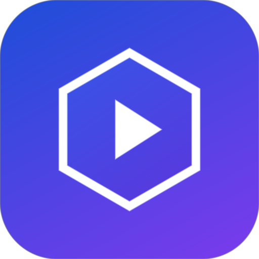
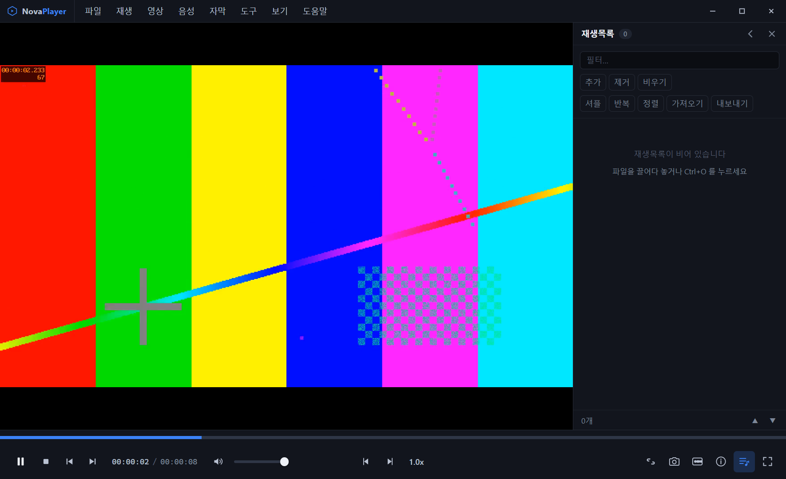

# Nova Player

[](./LICENSE)
[](https://github.com/gapfixnid/NovaPlayer/releases)
[](./package.json)

**광고도 추적도 없는 오픈소스 미디어 플레이어.** 거의 모든 포맷을 재생하고, 재생에 실패하면 재 mux와 실시간 트랜스코딩으로 자동 복구한다. 모든 처리는 로컬에서만 이루어진다.

[Download](https://github.com/gapfixnid/NovaPlayer/releases) · [Get started](#get-started) · [Privacy](#privacy) · [License](#license)



## Get started

1. 의존성을 설치한다.

    ```powershell
    npm install
    ```

2. 앱을 실행한다.

    ```powershell
    npm start
    ```

설치본과 포터블 EXE는 [Releases](https://github.com/gapfixnid/NovaPlayer/releases)에서 내려받거나 `npm run dist`로 직접 빌드한다.

## Features

- **Play anything** — MP4 · MKV · AVI · FLV · TS · RMVB · MP3 · FLAC, SRT · VTT · ASS · MicroDVD (EUC-KR 자동 감지)
- **자동 복구** — 네이티브 재생 실패 시 재 mux → H.264/AAC 트랜스코딩
- **조정** — 10밴드 EQ, 밝기 · 대비 · 채도 · 감마 · 회전, A-B 반복, 프레임 이동, 속도, 취침 타이머
- **프레임 단위 재생** — ffmpeg 기반 프레임 이동과 탐색바 썸네일
- **로컬 우선** — 기록은 로컬 JSON에만 저장, 텔레메트리 없음

## Development

```powershell
npm test         # 로직 단위 + main 스모크 테스트
npm run test:gui # 실제 구동 GUI 테스트 (재생 · 복구 체인 · IPC · 보안)
```

샘플 미디어가 필요하면 `node assets\make-test-media.js`로 생성한다. 단축키는 앱 내 **도구 → 단축키 목록**과 **설정 → 단축키**에서 확인 · 변경할 수 있다.

## Privacy

- 인앱 광고 · 서드파티 스크립트 · 텔레메트리 없음 (관련 코드 자체가 없음)
- 앱 내부의 외부 네트워크 요청 차단 (`http/https/ws` + CSP 이중 방어)
- 로컬 파일은 allowlist에 등록된 미디어만 `nova-media://`로 서빙
- 설정 · 재생 이력은 `%APPDATA%\Nova Player`에만 저장
- 관리자 권한 불필요

## License

[MIT](./LICENSE). Chromium과 ffmpeg는 각자의 라이선스를 따른다.
